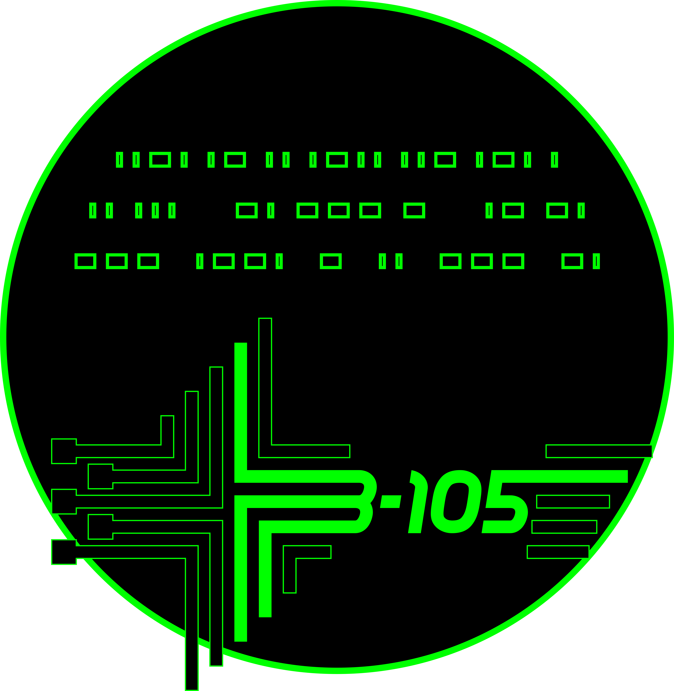
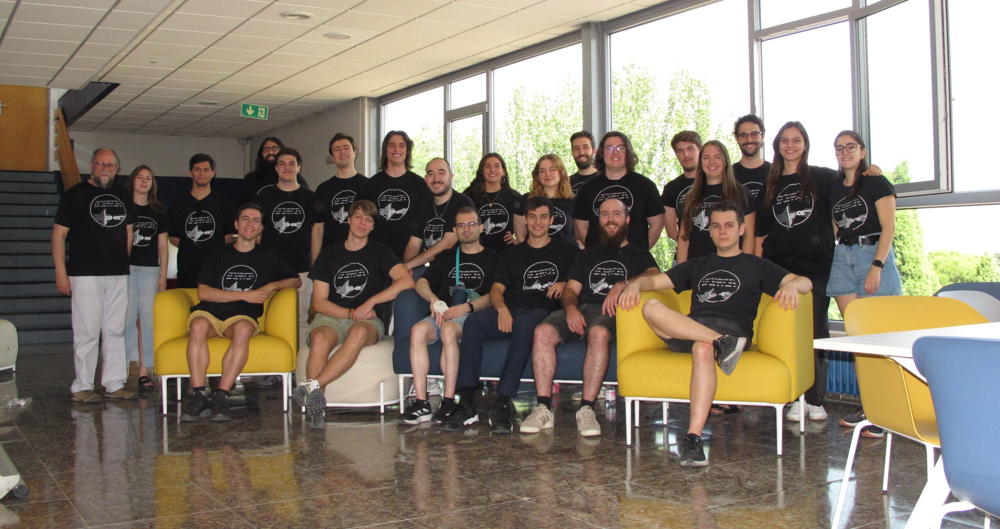

# B105 Electronic Systems Lab

**Embedded systems, wireless sensor networks and human networks — from neuroprostheses to satellites**

Research group of the Electronic Engineering Department · ETSIT · Universidad Politécnica de Madrid (UPM) 
Member of the [Information Processing and Telecommunications Center (IPTC)](https://iptc.upm.es/research-groups/)

*Failure is not an option*

---

## 👋 About us

B105 designs **embedded systems**: intelligent devices created with a specific purpose in mind. We cover the whole cycle — hardware and firmware design, prototyping and system testing — and take our devices out of the lab: into dams and bridges, road works, satellites, factories and, more recently, the brain.

The group is directed by **Prof. Octavio Nieto-Taladriz**, with **Prof. Alvaro Araujo** on the faculty, and brings together researchers, engineers and students from different backgrounds.

  
   The B105 team, 2026

| 👩‍🔬 Team | 🎓 Alumni | 📁 Completed projects | 📄 Journal articles |
|:---:|:---:|:---:|:---:|
| 2 faculty · 9 core members · 12 students | 125+ | 25+ | 40+ since 2010 |

## 🔬 Research areas

| | Area | Examples |
|---|---|---|
| 🧠 | **Neurotechnology** — neuroprostheses and stimulation systems | Thalamic visual prosthesis, closed-loop neurostimulation for stroke, adaptive deep brain stimulation |
| 🛰️ | **Space electronics** — on-board satellite devices | MPSoC on-board computers, CAN bus platforms, GNSS for PocketQubes, space-grade ADCs |
| 🤖 | **AI-enabled embedded systems** | Sensory substitution devices, presence detection, embodied AI |
| 🏭 | **Industry 4.0 hardware** | Self-powered wireless sensors, inspection robotics, energy harvesting |
| 📡 | **Wireless sensor & body networks** | IoT operating systems, time synchronization, cognitive radio, WBAN |

## 🚀 Ongoing projects

| Project | What we do | Funding | Period |
|---|---|---|---|
| [**VISNE**](https://elb105.com/visne/) | Thalamic visual prostheses to restore sight, stimulating the lateral geniculate nucleus. With UCM's Neuro-computing & Neuro-robotics group | Internal funds | 2022–2027 |
| [**MINA-CM**](https://elb105.com/mina-cm-madrid-innovative-neurotech-alliance/) | Madrid Innovative Neurotech Alliance: universities, CSIC and hospitals developing neurotechnologies | Comunidad de Madrid (P2022/BMD-7236) | 2023–2026 |
| [**STRIKE**](https://elb105.com/strike/) | New therapies for ischemic stroke: brain stimulation devices with real-time physiological monitoring | MINA-CM programme | — |
| [**THOR**](https://elb105.com/thor-building-vascular-networks-and-blood-brain-barriers-through-a-biomimetic-manufacturing-technology-for-the-fabrication-of-human-tissues-and-organs/) | Biomimetic manufacturing of vascular networks and blood–brain barriers. B105 builds the *spiderbots* | EIC Pathfinder Open (GA 101099719) | 2023–2026 |
| [**ORION**](https://elb105.com/orion/) | Octo Reconfigurable Converter: 8-channel, low-power, space-qualified ADC for digital beamforming | Horizon Europe | 2024–2028 |
| [**LINCE**](https://elb105.com/lince/) | MPSoC-based on-board computer and BSP alternatives for a microsatellite constellation | CDTI · NextGenerationEU | 2025–2027 |
| [**TEMBAI**](https://elb105.com/tembai/) | Towards an Embodied AI Through Sensory Substitution, with UAM and UC3M | Agencia Estatal de Investigación | 2025–2029 |

## 🏗️ Track record

Over the years we have closed [more than 25 projects](https://elb105.com/projects/projects-closed/) with public funding and industry partners:

- **Structural & infrastructure monitoring** — DAMAS (large dams), Puentes (bridges), SETH, S4BIM, ROBIM (building inspection robots with BIM)
- **Road safety** — DEPERITA, NODUM, Easysafe, SENSORIZA, Quitanieves, HOVIS, All-in-One
- **Health & accessibility** — MyGait (smart insoles for Parkinson's), S2Salud, LÁZARO
- **Industry 4.0 & robotics** — ESTAR, HUMAIN, Demotherm, Robot minero, 3D Sheet
- **Emergencies & IoT** — PROMETEO (wildfires), RALPH (radar), SONRISAS, LEDmyBike

## 📄 Latest publications

- J. Aráez, S. Real and A. Araujo, "A New Approach to ORB Acceleration Using a Modern Low-Power Microcontroller," *Sensors*, vol. 25, no. 12, 3796, 2025. [doi:10.3390/s25123796](https://doi.org/10.3390/s25123796)
- A. E. Zorkun, M. A. Salas-Natera, A. Araujo, R. Martínez Rodríguez-Osorio and M. Sierra Pérez, "A Mutual Coupling-Based Full Self-Online Calibration Method for Antenna Arrays in Uplink," *IEEE Open Journal of Antennas and Propagation*, vol. 5, no. 4, pp. 1026–1040, 2024. [doi:10.1109/OJAP.2024.3406067](https://doi.org/10.1109/OJAP.2024.3406067)
- A. Carretero and A. Araujo, "Design Decisions for Wearable EEG to Detect Motor Imagery Movements," *Sensors*, vol. 24, no. 15, 4763, 2024. [doi:10.3390/s24154763](https://doi.org/10.3390/s24154763)
- S. Real and A. Araujo, "Network QoS Impact on Spatial Perception through Sensory Substitution in Navigation Systems for Blind and Visually Impaired People," *Sensors*, vol. 23, no. 6, 3219, 2023. [doi:10.3390/s23063219](https://doi.org/10.3390/s23063219)
- P. Sarabia, A. Araujo, L. A. Sarabia and M. C. Ortiz, "Electromyography Gesture Model Classifier for Fault-Tolerant-Embedded Devices by Means of Partial Least Square Class Modelling Error Correcting Output Codes (PLS-ECOC)," *Algorithms*, vol. 16, no. 3, 149, 2023. [doi:10.3390/a16030149](https://doi.org/10.3390/a16030149)

➡️ [All publications](https://elb105.com/publications/our-publications/)

## 📦 Open resources

Tools, hardware and datasets we have released for the community:

| Resource | Type | What it is | Get it |
|---|---|---|---|
| [**YetiOS**](https://elb105.com/resources/yetios/) | Software | IoT operating system built on FreeRTOS for low-power sensor nodes | [Bitbucket](https://bitbucket.org/repoB105/yetios) |
| [**MIGOU**](https://elb105.com/resources/migou/) | Hardware | Energy-efficient wireless board (ARM Cortex-M3 + FPGA) that works as an IoT node or a software-defined radio | [Files · CC BY 4.0](https://elb105.com/resources/migou/) |
| [**GNSS for PocketQubes**](https://elb105.com/resources/pocketqubes/) | Hardware | GPS/Galileo/GLONASS receiver for PocketQube picosatellites, PQ9 compliant | [Bitbucket](https://bitbucket.org/repoB105/pocketcube/src/master/) |
| [**aDBS-EMU**](https://elb105.com/resources/adbs-emu/) | Software | Real-time emulator for adaptive deep brain stimulation | [Download](https://elb105.com/resources/adbs-emu/) |
| [**TSST**](https://elb105.com/resources/tsst/) | Software | Time-Synchronization Search Tool for wireless sensor networks | [Bitbucket](https://bitbucket.org/repoB105/tsst) |
| [**LEACH-Castalia**](https://elb105.com/resources/leach-castalia/) | Software | LEACH and LEACH-APP routing protocols for the Castalia 3.3 WSN simulator | [Download](https://elb105.com/resources/leach-castalia/) |
| [**Virtually Enhanced Senses**](https://elb105.com/resources/ves/) | System | Wireless sensor–actuator test bench for navigation aids for blind and visually impaired people | [Bitbucket](https://bitbucket.org/Knight025/ves_communicationsystem) |
| [**WBAN characterization**](https://elb105.com/resources/wban-characterization/) | Dataset | Body area network channel measurements in three ISM bands | [Download](https://elb105.com/resources/wban-characterization/) |

## 👥 Meet the team

<table align="center">
  <tr>
    <td align="center"><a href="https://elb105.com/nieto/"> <b>Octavio Nieto-Taladriz</b> Director</a></td>
    <td align="center"><a href="https://elb105.com/araujo/"> <b>Alvaro Araujo</b> Faculty</a></td>
    <td align="center"><a href="https://elb105.com/new-b105-main/people/sreal/"> <b>Santiago Real</b></a></td>
    <td align="center"><a href="https://elb105.com/anacp/"> <b>Ana Carretero</b></a></td>
  </tr>
  <tr>
    <td align="center"><a href="https://elb105.com/calleja/"> <b>Sandra Calleja</b></a></td>
    <td align="center"><a href="https://elb105.com/psarabia/"> <b>Pablo Sarabia</b></a></td>
    <td align="center"><a href="https://elb105.com/jaraez/"> <b>Jorge Aráez</b></a></td>
    <td align="center"><a href="https://elb105.com/dsg/"> <b>Daniel Sánchez</b></a></td>
  </tr>
  <tr>
    <td align="center"><a href="https://elb105.com/alimu/"> <b>Almudena Calatrava</b></a></td>
    <td align="center"><a href="https://elb105.com/juliagonzalezrecio/"> <b>Julia González</b></a></td>
    <td align="center"><a href="https://elb105.com/mrm/"> <b>Miguel Romero</b></a></td>
    <td align="center"><a href="https://elb105.com/new-b105-main/people/"><b>+ 12 students and 125+ alumni</b> See everyone →</a></td>
  </tr>
</table>

## 🎓 Students & credit

Many of our repositories are built by bachelor's (TFG), master's (TFM) and PhD students. **Every repository credits the people who built it** — check its README and commit history.

Recent student work includes closed-loop neurostimulators, transcranial magnetic stimulation simulators, through-body communication, CAN bus platforms for satellites and MPSoC satellite communication systems. Browse them all in the [students area](https://elb105.com/rookie-area/).

Each year the lab runs a series of [Research Meetings](https://elb105.com/new-b105-main/research-meetings/) where members present their work, and its [PhD theses](https://elb105.com/new-b105-main/phd-2/) span wireless sensor networks, energy-efficient operating systems and multisensory human–machine interfaces.

## 🤝 Industry chairs

We run scholarship programmes with industry: **Cátedra Verisure** (formerly Securitas Direct – Verisure, since 2019), **Navantia** (energy harvesting electronics on ships), **Kairós Digital Solutions** and **BQ**. See [Cátedras](https://elb105.com/admissions-2/catedras/).

## 🙋 Join us

> The only requirement to join B105 is to be motivated and willing to learn.

- [TFT offers 2026/2027](https://elb105.com/ofertas-tft-curso-2026-2027/) — TFG and TFM topics
- [Collaboration scholarships](https://elb105.com/oferta-de-becas-de-colaboracion/) and [research job offers](https://elb105.com/oferta-empleo-proyectos-investigacion/)
- PhD positions — [get in touch](https://elb105.com/admissions-2/contact/), or just drop by the lab

## 📬 Contact

📍 Lab B-105 · ETSIT-UPM · Av. Complutense 30, 28040 Madrid, Spain 
📞 +34 913 367 322 · 🌐 [elb105.com](https://elb105.com/) · ✉️ [Contact](https://elb105.com/admissions-2/contact/) 
💼 [LinkedIn](https://www.linkedin.com/company/b105-electronic-systems-lab/) · 📸 [Instagram @elb105esl](https://www.instagram.com/elb105esl/)

B105 Electronic Systems Lab · Universidad Politécnica de Madrid

